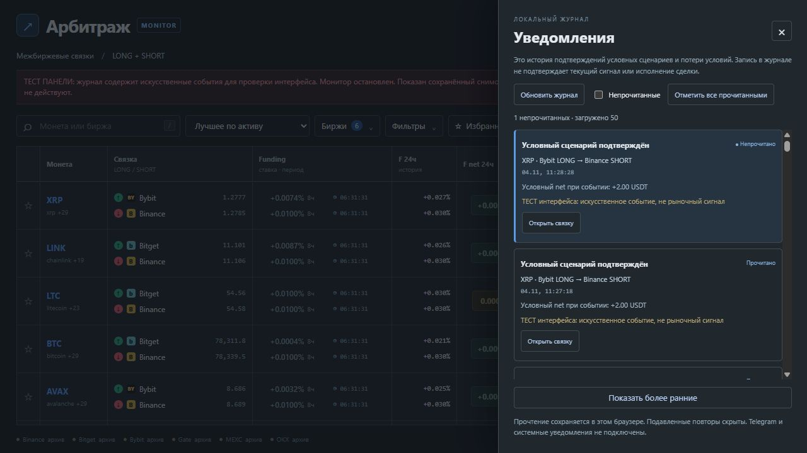
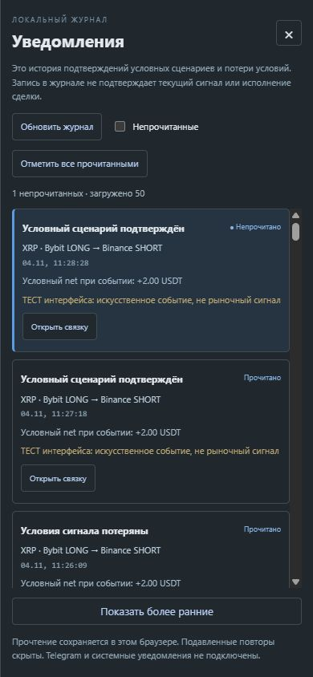

# Панель уведомлений 0.20 — 2026-11-05

Добавлены кнопка журнала в шапке, точный счётчик непрочитанных, боковая панель,
фильтр непрочитанных, ручное обновление, отметка всего журнала прочитанным,
подгрузка ранних записей и переход к направлению из текущего снимка.
Панель и её записи явно обозначены сохранённой историей, не действующими сигналами.
Отправки Telegram, системных уведомлений и звука в этой версии нет.

API остаётся read-only. Поля scope/latest_id/unread_count/has_older/has_newer
получаются в одной read-транзакции. Курсоры after_id и before_id взаимоисключающие;
read_through используется только для подсчёта, прочтение в SQLite не записывается.
Scope хеширует путь/идентификатор/время создания файла без выдачи самого пути клиенту.
Отметки хранятся отдельно по scope в localStorage; новый файл не наследует прочтение старого.
При недоступном localStorage интерфейс сообщает о временном сохранении в памяти.

По умолчанию загружается 50 последних уведомлений, более ранние — по 50.
В памяти UI максимум 500 записей; полный журнал доступен CLI.
Счётчик вычисляется по всему видимому журналу, не ограничен загруженным фрагментом.
Подавленные события не участвуют в счётчике/списке. Журнал опрашивается каждые 5с
при видимой странице; обработка обновлений не заменяет таблицу сканера.
При недоступном API сохранённые записи остаются историей с сообщением об ошибке.

162 Python-теста прошли (157 прежних и 5 новых). Проверены полный счётчик,
пагинация в обе стороны, невидимость suppressed, read-only неизменность файла,
стабильность scope после записи и его смена при замене базы, пустой/старый журнал,
неверные/конфликтующие курсоры. HTTP-тест покрывает параметры нового API.
11 проверок модели графиков и синтаксическая проверка JavaScript прошли.

Браузерная проверка использовала отдельную копию базы с **искусственными событиями**;
каждая запись и баннер содержали явную тестовую пометку. Рабочий журнал не изменялся,
тестовая база не переносилась в G:\Arbitrage. Не заявляются реальные положительные сигналы.

Проверены:

- Пустой журнал и отсутствие ложного счётчика.
- Автоматическое получение 90 тестовых записей.
- Загрузка последних 50 и подгрузка до 90.
- Прочтение всех записей, сохранение после перезагрузки, фильтр с пустой выдачей.
- Появление одной новой записи после прочтения: счётчик 1, фильтр показывает одну карточку.
- Переход к связке: открывается текущая архивная карточка с соответствующей пометкой.
- Escape закрывает панель и возвращает фокус на кнопку журнала.
- При ширине 390 px панель имеет 389 px, горизонтального переполнения нет.
- Ошибок/предупреждений консоли не было; временный сервер остановлен.

После установки нужен перезапуск сервера UI: старый процесс не выдаёт новые метаданные API.
Этап 10 остаётся частично выполненным: внешняя доставка и её настройки ещё впереди.

