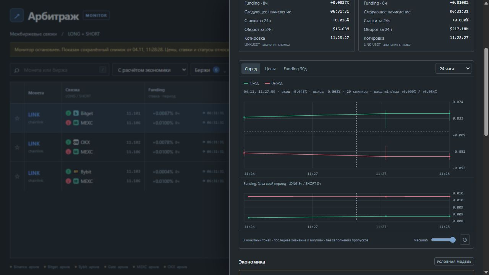

# Минутные графики 0.15 — 2026-11-04

140 тестов прошли в промежуточной и основной папках: прежние 134 и 6 проверок минутной истории.
В G:\Arbitrage также проверены отсутствие отставания сводок, неизменность базы при чтении
и отсутствие текущих подтверждений в архивном режиме.
Проверены последний снимок/min/max, неизвестный обратный спред, идемпотентность,
порционное заполнение, откат контрольной позиции и сводок вместе, старые базы,
день с 1439 точками и намеренно отсутствующей минутой, неизменность базы при UI-чтении,
использование индекса, периоды/stale/неизвестный funding, сохранение до удаления
сырых записей, ожидание агрегации и архивирование устаревших графических сводок.
HTTP-тест проверяет новый диапазон 1440 минут. JavaScript прошёл `node --check`.

На копии публичного прогона `data/ui-live.sqlite3` обработаны 61 скан / 61 снимок
экономики, получено 1070 минутных записей по направлениям/ставкам, отставание равно нулю.
Исходный прогон длился около двух минут: суточное окно не добавляет отсутствующие часы.
Контролируемый суточный fixture в тесте проверяет саму полноту диапазона более 300 точек;
он не является рыночной историей.

В отдельную новую базу воспроизведены 61 сохранённых снимков, до 300 направлений в снимке.
Полная операция сохранения raw/economics и обеих сводок: p95 27,30 мс, максимум 32,60 мс.
20 запросов карточки за 24ч: медиана 6,41 мс, максимум 6,56 мс; integrity_check=ok.
Это измерения короткой записи, а не большая месячная база или сетевой нагрузочный тест.
Точные значения: [CHART_HISTORY_METRICS.json](CHART_HISTORY_METRICS.json).
Повторение на новом выходном пути:

```powershell
.\.venv\Scripts\python.exe validate_chart_history.py --source data/ui-live.sqlite3 --snapshot data/ui-live.json --output data/chart-replay-new.sqlite3 --report data/chart-replay-new.json
```

Браузером проверены выбор «24 часа», минутные точки с min/max, курсор и подписи;
ошибок/предупреждений консоли не было. Временный сервер остановлен.
Окна 15м–24ч используют индексированные сводки; 1м оставляет подробный ряд.
Графики не доказывают непрерывное покрытие минуты или реальную доходность.
Длительный совместный прогон UI/монитора и масштабирование месячной базы остаются открытыми.


