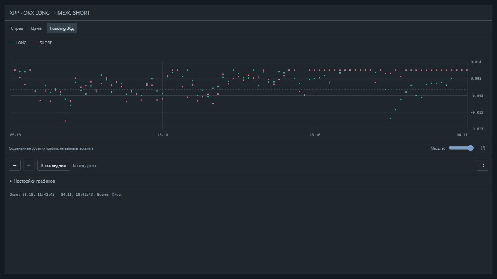
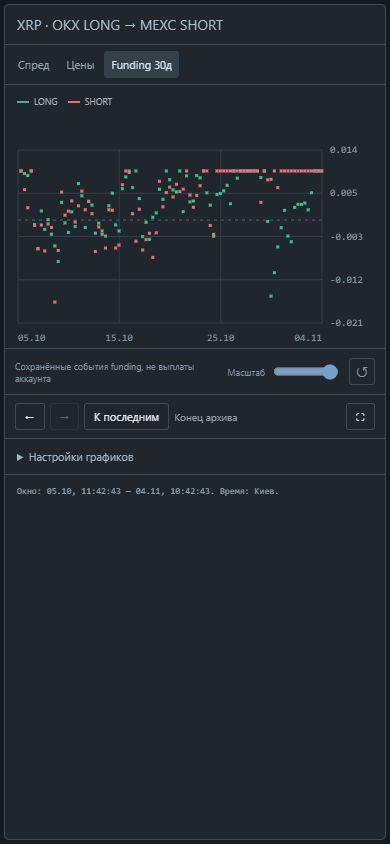

# Навигация и настройки графиков 0.17 — 2026-11-04

Графики получили независимую правую границу окна. Навигация не меняет текущую
карточку, экономику и таблицу сравнения funding. API `end_ms` читает прошлый участок
сырой/минутной истории и событий funding; будущее ограничено текущей доступной границей.
Неверные метки времени отклоняются. Чтение остаётся read-only.

Кнопки «Раньше»/«Позже» сдвигают окно на 80% видимой длительности, «К последним»
возвращает текущую правую границу и масштаб 100%. Историческая граница фиксируется
между обновлениями, а на конце live-график следует за данными.
Архив явно остаётся архивом. Неизвестная/достигнутая левая граница блокирует движение назад.
Исходные базы могут не содержать наблюдений выбранной связки в старом участке.

Масштаб теперь задаёт длительность окна (20–100%), а не число последних точек.
Для funding используется фиксированное окно 30 дней с тем же масштабом/навигацией;
селектор минут скрыт на этой вкладке. У графика явно подписаны начало/конец окна.
Отсутствующие интервалы остаются пустыми. При усечении funding-графика показана пометка
о 1000 последних событиях на ногу, выдача сохраняет хронологический порядок.

Курсор показывает ближайшую реальную запись с её временем: проценты входа/выхода,
цены LONG ask/SHORT bid или отдельные ставки LONG/SHORT. Поиск ограничен видимым окном
и расстоянием 10с для raw, 90с для минут, 6ч для исторических ставок.
В пустом промежутке показано «нет записи рядом», значение не интерполируется.
У цен ниже 1 USDT увеличена точность подписей оси.

Настройки браузера: высота основного графика 210/300/420/560 px, funding 110/160/220 px,
min/max минуты, сетка, нижняя funding-панель, сброс настроек. Они хранятся в localStorage.
Развёрнутый режим занимает область окна приложения; установка расширений и разрешений
браузера не требуется. Escape сначала закрывает настройки, затем развёрнутый режим,
затем карточку. Клавиши ←/→, E, F работают, когда фокус внутри графиков и вне полей ввода.

149 Python-тестов и 11 проверок JavaScript-модели прошли.
Новые тесты покрывают чтение прошлого raw/минутного окна, сохранность текущей карточки
и сравнения funding, будущую/неверную границу, порядок/лимит исторических ставок,
масштаб/границы навигации и отсутствие фиктивного значения курсора в пропуске.
JavaScript прошёл `node --check`.

В браузере на публичном архиве проверены движение назад/вперёд в минутном окне,
курсор цен и исторических ставок, возврат к последним, масштаб funding 30д → 6д,
высота 420 px, скрытие нижней панели, сохранение настроек после перезагрузки и сброс,
развёрнутый режим и выход Escape. При 390×844 ширина области графиков 380 px,
переполнения по горизонтали нет. Ошибок/предупреждений консоли не было.
Временные серверы проверки остановлены; постоянный сервис не установлен.
Большая месячная база и длительный совместный прогон UI/монитора пока не проверены.

