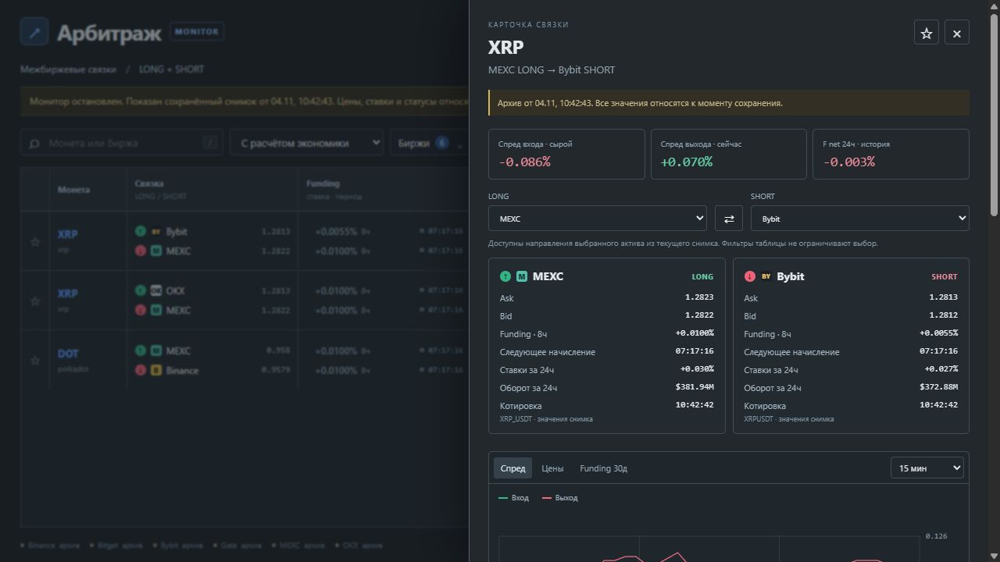
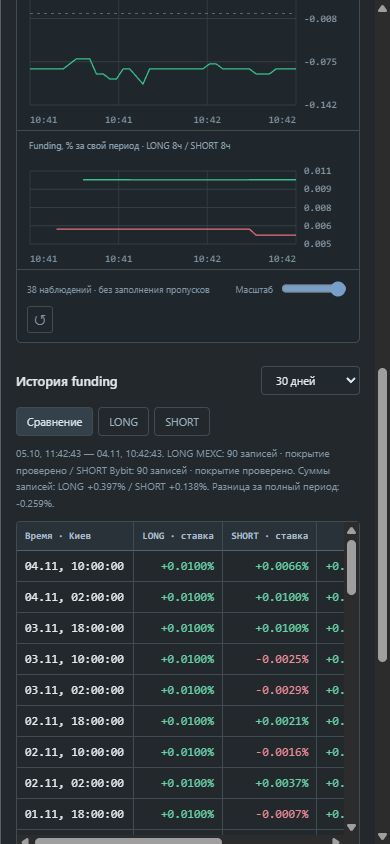

# Смена ног и сравнение funding 0.16 — 2026-11-04

Добавлены отдельные селекторы LONG/SHORT и разворот направления в карточке.
Опции строятся по направлениям того же актива, реально присутствующим в снимке,
с сохранением противоположной ноги. Фильтры видимой таблицы не ограничивают их.
Если обратного направления нет, кнопка разворота недоступна.
Во время загрузки выбор заблокирован; старые цены, расчёт и история очищаются.
Поздние ответы предыдущих запросов не подменяют новую связку.

Таблица funding имеет представления LONG, SHORT и сравнение, окна 1/3/7/14/28/30 дней,
по 50 строк с подгрузкой. Время общего окна одинаково для обеих ног, события
объединяются по фактическим меткам. Пустая ячейка — отсутствие записи, не нулевая ставка.
Суммы вычисляются в хронологическом порядке через Decimal; вывод — от новых к старым.
Разница = сумма SHORT − сумма LONG при одинаковом условном номинале.
Это сравнение публичных ставок, не выплаты позиции или фактический PnL.

Полная разница окна доступна только при проверенных левой границе, регулярности
ритма и свежести правой границы на обеих ногах, без ошибки импорта и усечения.
Эта проверка наблюдаемого покрытия использует существующий window_stats и не подтверждает
полноту внешнего API независимо от его записей. Неполные суммы видны с пометкой.
Максимум 1000 последних событий на ногу; усечение явно показано и снимает полное покрытие.
UI и API остаются read-only, сетевых запросов к биржам при смене ног нет.

145 автоматических тестов прошли: прежние 140 и 5 новых проверок.
Новые случаи: разные интервалы 1ч/4ч, общий период, знак/арифметика сумм,
исключение будущих/чужих событий, пропуски и ошибка импорта, пустая база,
отличие известного нуля от неизвестного, предел событий, разворот и отсутствие переноса
экономики/подтверждений с предыдущего направления. HTTP-тест проверяет неверный период.
JavaScript прошёл синтаксическую проверку.

В браузере на сохранённой публичной базе auto-care-live проверены смена LONG и SHORT,
разворот, очистка прежней экономики, выбор 30 дней, три представления,
подгрузка с 50 до 90 строк, чтение покрытого окна и суммы по выбранным площадкам.
При 390×844 карточка имеет ширину 374 px без переполнения, таблица прокручивается
внутри области 342 px. Ошибок/предупреждений консоли не было.
Временный сервер остановлен. Эта работа не заменяет длительный живой прогон UI.

