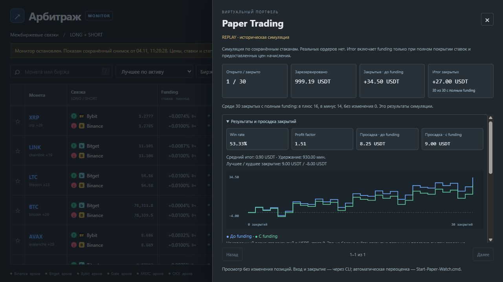
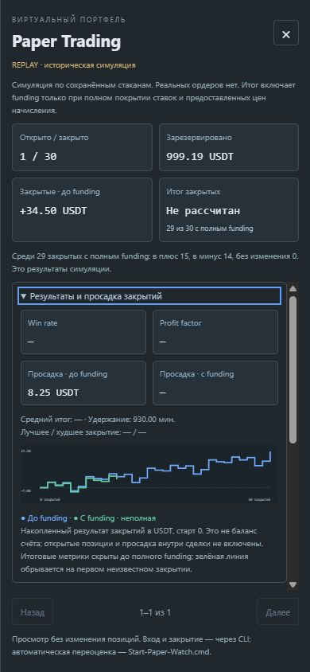

# Проверка paper-статистики 0.28 — 2026-11-05

Добавлены глобальные read-only метрики закрытых позиций и локальный SVG-график.
Существующие позиции пользователя не изменялись. UI/таблица scanner не пересоздаются
для показа статистики; в paper-панели используется общая область прокрутки.

8 новых тестов проверяют:

- Для последовательности net 10, −4, −8, 5: накопленный итог 3, просадка 12 USDT,
  win rate 50%, profit factor 1.25, средний net 0.75; удержание 150 минут.
- Пропуск funding обрывает накопленный net и исключает итоговые метрики, без нуля/склейки.
- Совпадающие времена закрытия суммируются группой без выдуманного порядка.
- Пустая/нулевая история и отсутствие убытков без Infinity.
- 5000 закрытий, ограничение 281 точкой, сохранение кратких пика 100 / провала −50;
  максимальная просадка 150 считается по всем исходным точкам.
- Сохранение первой неизвестной границы при сокращении.
- Пересчёт всей истории после восстановления funding.
- Отказ на некорректных временах или несогласованном числе закрытий.

Полный набор: **251 Python-тест и 11 проверок JS прошли**; JS прошёл проверку синтаксиса.

Браузерная проверка на собственном preview 8774: 1 открытая и 30 закрытых
**искусственных replay-позиций**, не рыночные результаты. Проверены полный итог и
последующее удаление net одного закрытия: зелёная линия обрывается, итоговая
просадка/win rate/profit factor становятся «—». Синяя линия остаётся доступна.
Проверены раскрытие, прокрутка, Escape/возврат фокуса, 1280×720 и 390×844;
documentWidth=390 на мобильном, ошибок JS не наблюдалось. Viewport сброшен,
собственный preview и тестовая вкладка закрыты; пользовательский сервер 8765 не трогали.

Формулы и ограничения: [PAPER_STATISTICS.md](../PAPER_STATISTICS.md).
Длительная рыночная устойчивость, внутрисделочная equity, точные адаптеры остальных
бирж и автоматические правила paper-входа/выхода ещё не выполнены.
