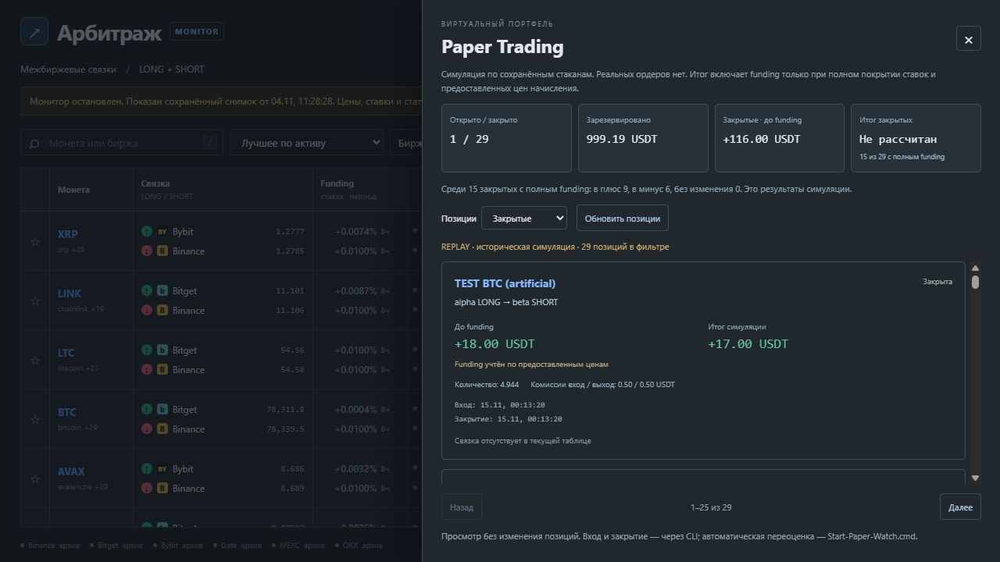
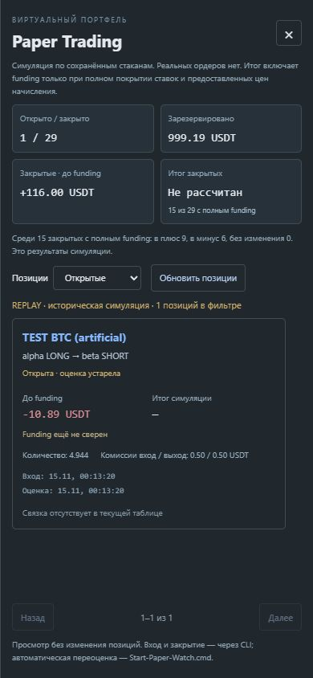

# Проверка paper-панели 0.25 — 2026-11-05

Добавлены read-only API `/api/paper`, фильтруемая панель UI и статистика закрытых
позиций. Ордеров и операций с пользовательскими позициями в проверке не было.

8 новых Python-тестов проверили:

- Проекцию полей, сроки свежести/устаревания, read-only исходную SQLite.
- Фильтры, страницы без пересечений, глобальную сводку, сброс уходящего offset.
- Неизвестный net без нулевой подстановки/частичного общего итога; отдельные числа
  плюсовых/минусовых/нулевых закрытий с полным funding.
- Отсутствующий/старый файл, replay и историческое закрытие.
- Валидацию параметров, пути по умолчанию/кастомный, GET/POST и 503 повреждённой базы.
- Доступность новых статических JS/CSS с существующей CSP.

Полный набор: **222 Python-теста и 11 проверок JS прошли**. Синтаксис обоих
скриптов UI проверен Node. Браузерная проверка — собственный loopback preview 8773,
основной сервер пользователя не изменялся. Preview и тестовая вкладка закрыты.

Контролируемый journal: **1 открытая + 29 закрытых искусственных replay-позиций**,
15 закрытых с заданным тестовым net. Числа не являются доходностью проекта.
Проверены:

- Пустой журнал до создания контролируемого файла.
- Replay-пометка и устаревшая открытая оценка.
- Общий net «Не рассчитан» при 15/29 полных закрытиях.
- Страницы 1–25 и 26–29, фильтры, ручное обновление.
- Контролируемый 503 после временной порчи тестового файла: сохранённый ответ и
  предупреждение; после восстановления — нормальная загрузка.
- Shift+Tab внутри панели, Escape/возврат фокуса, отдельная панель уведомлений.
- 1280×720 и 390×844: мобильная панель шириной 390, documentWidth=390,
  без горизонтального переполнения. Временное изменение viewport сброшено.
- Ошибок JavaScript после восстановления/перезагрузки не наблюдалось.

Снимки с пометкой TEST/replay:

Живые paper-позиции, многомесячная нагрузка, автоматическая загрузка settlement
mark prices, фоновая funding-сверка, графики equity/drawdown и автоматические
правила paper-входа/закрытия остаются впереди. Этап 11 частичный.
