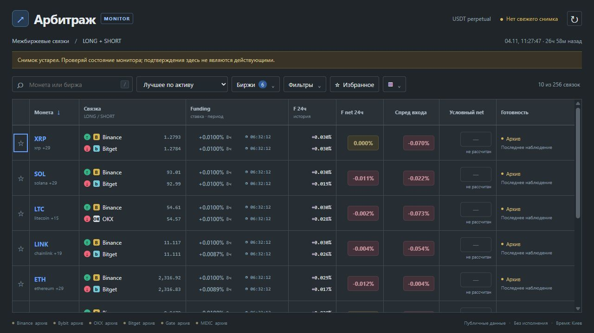

# Исправление обновления таблицы 0.19.1 — 2026-11-05

Область изменения — только отображение сканера. Логика сбора, расчёта и уведомлений
не менялась. Вместо замены `tbody.innerHTML` выполняется обновление атрибутов и текстовых
узлов существующих строк. В режиме «Лучшее по активу» ключ — asset, в остальных — ID
направления. Добавляются/удаляются только появившиеся/исчезнувшие строки; сортировка сохранена.
Кнопки остаются в DOM; при перемещении строки сохраняется фокус без прокрутки.

Для сканера включена фиксированная раскладка колонок, высота строк 76 px, ограничено
переполнение содержимого. Под вертикальную полосу прокрутки постоянно резервируется место,
автоматическое смещение scroll anchor отключено. Скрытие колонок сохраняет работу.

Браузерная проверка выполнялась при воспроизведении 24 сохранённых публичных снимков
из предыдущего прогона. Исходные данные не объявлялись свежими.
При изменении цены 1.2793 → 1.2786 и времени снимка 11:27:49 → 11:28:19:

- ширина таблицы осталась 1211 px;
- все девять ширин колонок совпали до и после обновлений;
- все строки сохранили высоту 76 px;
- строка BTC сохранила accessibility ID 458;
- фильтр с 10 до 1 строки не изменил ширины колонок;
- в режиме всех направлений scrollTop остался 3664 px после обновлений;
- проверены скрытие/возврат дополнительных колонок, ошибок консоли нет.

Синтаксическая проверка JavaScript, 157 Python-тестов и 11 проверок модели графиков
прошли. Временный сервер воспроизведения остановлен.
Для уже открытой страницы достаточно обновления; новый backend или перезапуск монитора не нужен.

Метрики: [UI_TABLE_STABILITY_METRICS.json](UI_TABLE_STABILITY_METRICS.json).

