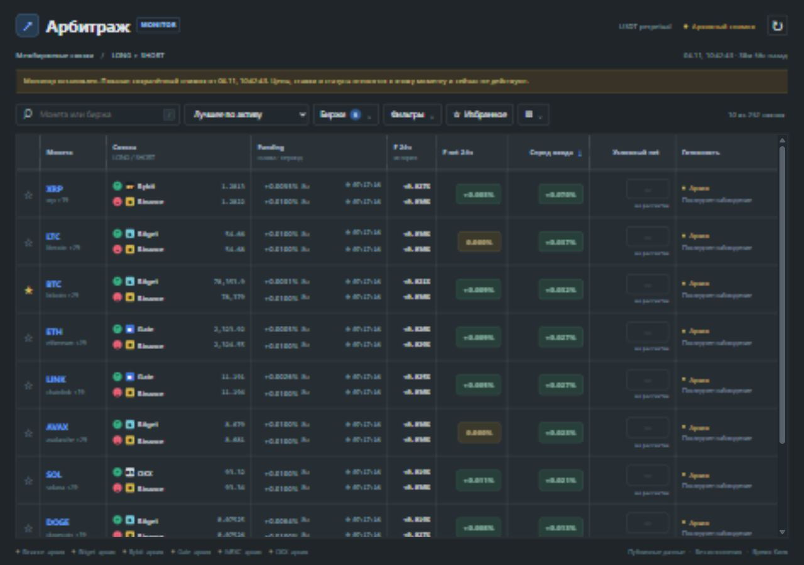
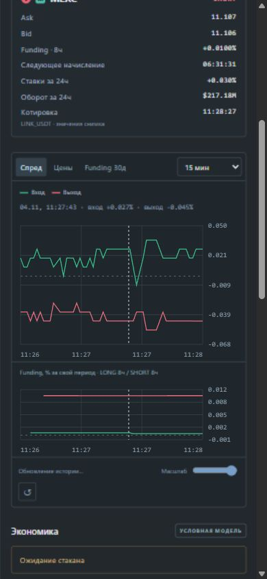

# Проверка первого UI — 2026-11-04

Версия 0.14, этап 9 частично выполнен. Референсы: [UI_REFERENCE.md](../UI_REFERENCE.md).

134 автоматических теста прошли: прежние 128 и 6 новых UI-тестов.
Проверены формула обратного спреда, нормализация контрактов, неизвестные значения,
потеря текущего подтверждения при старении котировок/funding, архив, неизменность SQLite,
реальные точки истории, разрешённые HTTP-методы, пути статики и допустимые интервалы.
JavaScript прошёл `node --check`. Те же проверки повторяются из основной папки G:\Arbitrage.

В браузере проверены поиск BTC, три режима, фильтры порогов/бирж, пустая выдача,
колонки, избранное с сохранением после перезагрузки, открытие разных связок,
карточки экономики, графики спреда и funding, диапазон времени, масштаб 20% и сброс.
На архиве с импортом funding проверена вкладка фактических начислений за 30 дней.
На отдельном публичном запуске интерфейс наблюдал живой режим и последующий переход
в помеченный архив после штатной остановки. Ошибок/предупреждений в консоли не было.

Проверены размеры 1280×900 и 390×844. Обнаруженный выход фильтров за левый край
узкого окна исправлен; панель помещается в ширину экрана. Неизменившиеся строки больше
не заменяются каждую секунду, чтобы не мешать нажатию и фокусу.
Временный сервер проверки остановлен после работы; постоянный фоновый сервер не установлен.

Публичный прогон сохранён в `data/ui-live.json`, `data/ui-live.sqlite3`,
`data/ui-live-report.json`: 121,4805 секунды, последний активный скан — 252 направления.
Код завершения 1 связан с неполной свежестью последней выборки, а не падением UI.
После остановки архив не имеет действующих подтверждений. Это короткая интеграционная
проверка, не суточный тест и не доказательство прибыльности.

Ограничения: графики текущей реализации читают максимум 300 снимков;
6-часовое окно не гарантирует полноту истории. Не все строки имеют экономику/оборот:
глубина рассчитывается только для выбранных кандидатов. Проверка полномасштабной истории
и длительной работы UI остаётся открытой.

