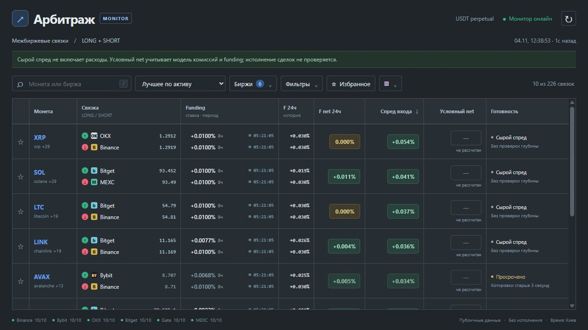
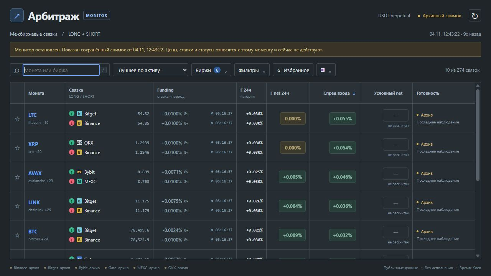

# Большая история и совместный прогон 0.18 — 2026-11-04

Базовый интерфейс для текущего явного реестра прошёл функциональные и ограниченные
интеграционные проверки. Этап 9 завершён в этом объёме; суточная устойчивость,
масштабирование охвата и проверка полного MVP остаются в этапах 6 и 12.

## Контролируемая большая база

- 30 направлений × 30 дней минутных точек: 1 296 029 записей после намеренного пропуска.
- Дополнительно 200001 небольшой сырой снимок; SQLite 626 978 816 байт (около 598 МиБ).
- 120 HTTP-запросов старых суточных окон, 4 параллельных клиента.
- Медиана 142,42 мс; p95 158,20 мс; максимум 169,54 мс; максимум ответа 654434 байта.
- Все 120 ответов сверены по числу точек и времени; отдельно проверено окно с пропуском.
- План запроса использует индекс `(series,start_ms)`, integrity_check=ok.
- Первый state при пустом прикладном кэше — 10,17 мс. Кэш ОС не очищался.

**Это искусственная база с повторёнными шаблонами цен, не месяц рыночных данных.**
Проверка не охватывает полный месяц всех 300 направлений и весь объём исходных стаканов.
База создавалась отдельно от живого прогона, но запросы выполнялись параллельно ему
на той же машине. Модели доходности по этим данным не оценивались.

Машинный отчёт: [UI_HISTORY_LOAD_METRICS.json](UI_HISTORY_LOAD_METRICS.json).
Большой тестовый файл остаётся во вспомогательной папке разработки; в рабочую папку
переданы скрипт и отчёт. Его можно воспроизвести по [UI_VALIDATION.md](../UI_VALIDATION.md).

## Публичный монитор + HTTP UI

Новая отдельная папка с копией прежнего архива funding; основная база не изменялась.
Длительность монитора 601,78с; клиент завершил проверки за 604,96с.
Шесть бирж, 10 активов / 60 контрактов, до 300 пригодных направлений.

| Проверка | Результат |
|---|---:|
| Автоматические запросы state | 298 |
| Запросы карточек и сверки времени | 298 |
| Ошибки HTTP/проверок | 0 |
| Ожидаемые 404 при смене отбора | 0 |
| State: медиана / p95 / максимум | 20,60 / 25,48 / 1029,80 мс |
| Карточка: медиана / p95 / максимум | 12,55 / 14,73 / 26,09 мс |
| Максимум RSS процесса монитора | 417644544 байта (~398 МиБ) |
| Средний CPU монитора, доля одного ядра | 17,78% |
| Публикация монитора, p95 | 62,28 мс |
| Задержка event loop монитора, p95 | 1,34 мс |
| Рост SQLite за прогон | 138207232 байта (~132 МиБ) |
| Итоговый размер SQLite | 157331456 байт (~150 МиБ) |
| Отставание графических сводок | 0 сканов / 0 снимков экономики |

Разовый максимум state около 1,03с отражён в отчёте; причина отдельного выброса не
установлена. Числа относятся к этому запуску и аппаратной среде, а не гарантии задержек.
RSS/CPU измерены для монитора, не суммарно для браузера и всех процессов стенда.

Монитор штатно достиг длительности. Его код 1 связан с неполной свежестью последней
выборки, не с ошибкой UI. После остановки 274 архивных направления показаны явно
историческими, без свежих котировок и текущих подтверждений. Это проверено отдельным
HTTP-запросом и в браузере. Архивирование не объявлено действующим прибыльным сигналом.
SQLite integrity_check=ok. Обслуживание выполнило 11 циклов без ошибок, архив funding
60 контрактов использован из свежего кэша; удалений по сроку в этом запуске не требовалось.

Браузер показал live и затем автоматически перешёл в архив; ошибок/предупреждений
консоли нет. Созданные тестом процессы завершаются после окна просмотра архива.
Основные snapshot/database не заменялись, торговые ключи и ордера не использовались.
Десять минут не подтверждают суточную устойчивость или прибыльность.

Машинный отчёт: [UI_SOAK_METRICS.json](UI_SOAK_METRICS.json).
149 Python-тестов и 11 проверок JavaScript-модели прошли.

