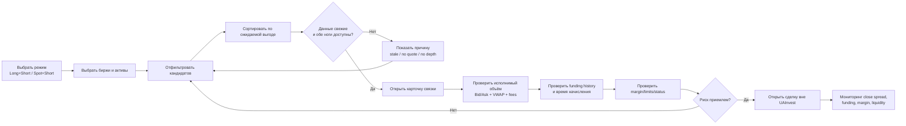
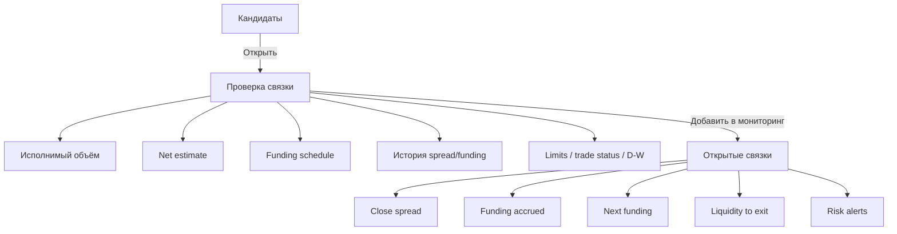
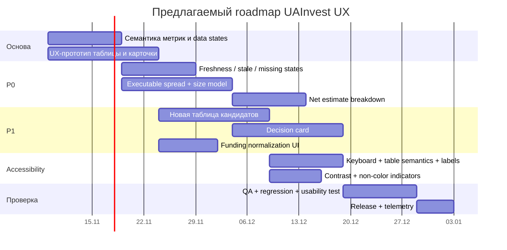

# Аналитический UX-аудит интерфейса UAInvest Arbitrage

## Резюме для принятия решений

UAInvest уже содержит большую часть функционального «сырья», необходимого профессиональному арбитражному монитору: несколько режимов Long/Short и Spot/Short, фильтрацию по биржам и рыночным показателям, funding-метрики, Open Spread, историю, OI, индексные компоненты, статусы депозитов/выводов, отдельную карточку связки и элементы оценки ликвидности. В приложенном исследовании также подтверждены рабочие сценарии поиска монеты, смены режима, сортировки, фильтрации, перехода к карточке, просмотра истории, графиков и альтернативных ног. fileciteturn0file1 Официальная текущая страница UAInvest дополнительно показывает сохранение фильтров для авторизованных пользователей; это важное уточнение к приложенному исследованию, где публичный сценарий сохранённых пресетов не был подтверждён. citeturn584624search1turn584624search4

Основная UX-проблема продукта не в нехватке данных, а в том, что интерфейс одновременно пытается быть **скринером, аналитическим терминалом и справочником**, не выстраивая достаточно жёсткую иерархию между тремя задачами. Пользователь видит Fund, Fund 24, F Spread, F Spread APR, Open Spread, D/W, Liq, Slip, несколько направлений стрелок и цветовые сигналы до того, как получает однозначный ответ на главный вопрос: **«Что именно я должен сделать, какой объём реально исполним и сколько останется после издержек?»** Это противоречит эвристикам Nielsen «соответствие системе реальному миру», «видимость состояния системы» и «эстетичный и минималистичный дизайн»: интерфейс должен говорить языком задачи и выделять информацию, непосредственно поддерживающую решение. citeturn705756search0

Наиболее серьёзные проблемы — отсутствие явного статуса свежести котировок при пропусках Bid/Ask, смешение индикативных и исполнимых величин, слабая семантика ряда обозначений и недостаточно очевидная связь между таблицей и реальным сценарием сделки. В исследовании MYX одновременно наблюдались известные funding-значения и прочерки в Bid/Ask и Open/Close Spread; отдельного надёжно идентифицируемого stale-state не было. fileciteturn0file1 Для торгового интерфейса это проблема уровня **severity 4/4** по моей экспертной оценке: Nielsen определяет 4 как «usability catastrophe», а сам severity складывается из частоты, влияния и устойчивости проблемы. citeturn675924search0

Вторая группа критичных проблем — **информационная плотность и семантическая неоднозначность**. Например, F Spread в таблице означает нормализованную текущую разницу funding, тогда как одноимённый фильтр фактически задаёт минимальный APR; «Ліміт» отображается без однозначного объяснения типа ограничения; D/W показывает доступность сети, но не торговый статус perpetual; значения Liq и Slip могут быть прочерками без объяснения причины. fileciteturn0file1 Такие расхождения увеличивают вероятность того, что опытный пользователь будет перепроверять данные вручную, а начинающий — интерпретировать метрики неверно.

Конкурентный анализ показывает устойчивый паттерн рынка: CoinGlass делает основной акцент на готовом портфеле Long/Short, APR, net funding, spread и settlement; Coinalyze явно разделяет текущий и прогнозный funding и позволяет нормализовать ставки к 1 часу, 8 часам, суткам, неделе и году; Laevitas строит более аналитический рабочий стол с advanced filters, saved filters и историческими графиками; ArbitrageScanner подчёркивает максимальный funding-spread и использует более простой «таблица → связка» путь; CoinAnk группирует funding внутри более широкой derivatives-навигации. citeturn379068search0turn379068search4turn379068search8turn685392search1turn379068search6 UAInvest выгодно отличается сочетанием **price spread + funding + статусы сетей + детальная карточка**, но уступает лучшим конкурентным паттернам в объяснимости результата и progressive disclosure.

Главная продуктовая рекомендация — перестроить опыт вокруг трёх последовательных уровней:

**скрининг → проверка исполнимости → мониторинг открытой связки.**

В таблице следует оставить только показатели, необходимые для первичного решения; расширенную математику и технические детали показывать в карточке. Центральной метрикой должна стать не абстрактная APR, а **«оценка результата для выбранного размера»** с явным разложением на входной спред, funding, комиссии и slippage, причём все неизвестные или stale-компоненты должны блокировать статус «исполняемо». Такой подход соответствует Nielsen «recognition rather than recall» и «error prevention»: пользователю не приходится держать формулы и семантику колонок в памяти, а система предупреждает ошибку до входа. citeturn705756search0

При небольшой продуктовой команде — **1 product/UX designer, 1 frontend engineer, 1 backend/data engineer и QA примерно на 0,5 ставки** — реалистичный UX/инженерный roadmap занимает около **10–12 недель**: сначала семантика данных и stale-state, затем новая таблица и карточка исполнимости, затем accessibility/polish и пресеты. Это проектная оценка, а не наблюдаемый факт.

## Методология, объект исследования и ключевые пользовательские потоки

Аудит основан на двух вложениях: первое задаёт расширенный исследовательский контекст по межбиржевому арбитражу, рискам, funding, ликвидности и мониторингу, fileciteturn0file0 второе содержит фактическое исследование UAInvest, выполненное 8 ноября 2026 года с проверкой таблицы, карточек MYX и CLAUDIA, графиков, фильтров, URL-параметров и части сетевых состояний. fileciteturn0file1 Дополнительно текущие публичные страницы UAInvest были перепроверены по официальным материалам, а конкурентный benchmark проведён по действующим интерфейсам и документации на ту же дату. citeturn584624search0turn584624search1turn584624search2

Эвристическая оценка использует десять принципов Nielsen, а severity — шкалу 0–4. Важно, что это **экспертный аудит**, а не полноценное usability-тестирование с пользователями; NN/g отдельно отмечает, что оценка от одного эксперта менее надёжна, чем агрегированная оценка нескольких специалистов. citeturn675924search0 Accessibility-часть также является проверкой рисков по наблюдаемому интерфейсу, а не сертификацией соответствия WCAG 2.2.

Основной пользовательский сценарий, подтверждённый приложенным исследованием, выглядит так: выбрать стратегический режим → ограничить биржи → применить фильтры → отсортировать → открыть связку → проверить стороны и funding → посмотреть историю/цены/OI → оценить ограничения и ликвидность → принять решение. fileciteturn0file1 Официальный FAQ UAInvest описывает тот же ментальный процесс: для Long+Short пользователь выбирает стороны по funding и одновременно учитывает входной spread, ликвидность, историю ставок и торговые ограничения. citeturn584624search0



Ключевое улучшение этого потока — сделать узел **«данные свежие и исполнимы?»** системным gate, а не оставлять пользователю задачу самому интерпретировать прочерки. Сейчас исследование фиксирует ситуации, где Bid/Ask отсутствуют, но funding и графики продолжают отображаться; причина отсутствия котировки при этом не раскрыта. fileciteturn0file1 В финансовом интерфейсе неизвестность должна быть оформлена как отдельное состояние данных, а не как визуальный символ «—».

С точки зрения доступности таблица требует особого внимания. W3C рекомендует программно связывать заголовки и данные таблицы и передавать состояние сортировки через `aria-sort`; для сложных таблиц могут потребоваться явные связи заголовков. citeturn705756search5turn705756search6 Форм-контролы должны иметь однозначные текстовые labels, связанные с элементами ввода, что особенно важно для многочисленных числовых фильтров. citeturn705756search3 WCAG 2.2 также требует минимального текстового контраста 4.5:1 для обычного текста, минимального target size 24×24 CSS px на уровне AA и видимого, не перекрытого keyboard focus. citeturn705756search1

## Эвристический аудит ключевых экранов и потоков

Ниже severity используется в смысле Nielsen: **4 — критическая проблема, 3 — серьёзная, 2 — умеренная, 1 — косметическая.** citeturn675924search0

| Проблема | Наблюдение и первопричина | Nielsen / WCAG | Severity | Риск для пользователя |
|---|---|---|---:|---|
| Нет однозначного stale/error-state для котировок | На MYX funding известен, Bid/Ask и вход/выход — «—»; причина не объяснена. fileciteturn0file1 | Visibility of system status; Help users diagnose errors citeturn705756search0 | **4** | Пользователь может считать неполный набор данных актуальным |
| Индикативные и исполнимые показатели стоят на одном уровне | Last/табличные цены, Open Spread, funding и потенциальные Liq/Slip визуально выглядят как равноценные сигналы, хотя исполнение зависит от Bid/Ask и глубины. fileciteturn0file1 | Match with real world; Error prevention citeturn705756search0 | **4** | Ошибочная оценка реальной доходности |
| Семантика F Spread конфликтует с фильтром | Колонка F Spread отображает нормализованную ставку за 8h, но фильтр с этим названием задаёт минимальный APR. fileciteturn0file1 | Consistency and standards | **3** | Ошибочная фильтрация и сравнение кандидатов |
| «Ліміт» не объясняет, какой именно лимит показан | Исследование не смогло определить, position limit это, order limit, risk-tier или другая величина. fileciteturn0file1 | Match with real world; Help/documentation | **3** | Пользователь неверно считает максимально возможный размер |
| D/W визуально близок к торговому статусу | D/W относится к депозиту/выводу актива, но возможность открыть perpetual — другой статус. fileciteturn0file1 | Consistency; Error prevention | **3** | Сеть доступна, но контракт может быть ограничен |
| Слишком много равноправных колонок в первичном скринере | Fund, Fund24, APR, F Spread, Open Spread, status, liquidity и slippage одновременно конкурируют за внимание. fileciteturn0file1 | Aesthetic and minimalist design citeturn705756search0 | **3** | Рост времени на сравнение, особенно у новичков |
| APR визуально выглядит как сильный KPI | UAInvest сам характеризует APR как справочный показатель; текущая funding-разница может быстро изменяться. citeturn584624search0 | Error prevention | **3** | Сверхоптимистичное восприятие доходности |
| Непрозрачные состояния Liq/Slip | В публичной проверке переключатели существовали, но строки показывали «—»; причина и доступность не объяснены. fileciteturn0file1 | Visibility of status | **3** | Неясно: нет данных, нет глубины или функция платная |
| Цвет несёт существенную смысловую нагрузку | Funding и spread активно кодируются зелёным/красным. fileciteturn0file1 | WCAG 1.4.1 запрещает использовать цвет как единственный способ передачи информации. citeturn754196search1turn754196search3 | **3** | Потеря смысла для части пользователей |
| Сортировка недостаточно объясняет состояние | Клики по заголовкам меняют направление, но для assistive technology важно программно сообщать sort-state. fileciteturn0file1 | WCAG 1.3.1; `aria-sort` citeturn705756search5turn705756search7 | **2–3** | Клавиатурный/скринридер-пользователь может потерять контекст |
| Фильтры требуют знания терминологии | MCap, FDV, funding delta, cross-stable quotes и разные интервалы представлены компактно и ориентированы на уже обученного пользователя. fileciteturn0file1 | Recognition rather than recall; Match with real world | **2** | Высокий порог входа |
| Пустая выдача мало помогает восстановиться | Для несуществующего coin получено ноль строк; исследование не фиксирует диагностирующее empty state. fileciteturn0file1 | Help users recover | **2** | Пользователь не знает, снять ли фильтры или сменить актив |

Самый высокий приоритет следует отдать **типологии состояний данных**. Вместо одного символа «—» интерфейс должен различать минимум четыре случая: «нет котировки», «котировка устарела», «рынок приостановлен», «данных недостаточно для заданного объёма». Это делает состояние системы наблюдаемым, что прямо соответствует первой эвристике Nielsen. citeturn705756search0

Рекомендуемый паттерн для таблицы:

> **Нет свежей цены** · последнее обновление 42 сек назад  
> Расчёт входа временно отключён.

Для недостаточной глубины:

> **Можно исполнить ≈ $310 из $500**  
> Оценка прибыли для $500 недоступна.

Для отсутствующего значения:

> **Funding history неполная** · 11 из 24 часов  
> Не использовать Fund 24 как полный суточный результат.

Microcopy здесь должна называть **причину и последствие**, а не только состояние. Это также согласуется с WAI-рекомендацией давать ясные и конкретные инструкции при ошибке или проблеме ввода. citeturn705756search4

В основной таблице я рекомендую сократить первичный набор до: **Актив → Long/Short venues → Исполнимый вход → Net funding → Ожидаемый результат для суммы → Liquidity → Risk state.** Fund24, APR, MCap/FDV, D/W и технические параметры перемещаются в expandable row или карточку. Это не означает удалять данные; Nielsen подчёркивает, что минимализм — это снижение конкуренции нерелевантной в данный момент информации с основной. citeturn705756search0

Карточку связки целесообразно перестроить по принципу «decision panel first»:

| Сейчас | Рекомендуемый верх карточки |
|---|---|
| Две биржевые панели + funding + Bid/Ask + различные показатели | **Long Gate / Short MEXC — $500** |
| Вход/выход и графики отдельно | **Executable entry: +1.34%** |
| APR и funding рядом | **Expected 8h carry: +0.18%** |
| Liq/Slip отдельно или отсутствуют | **Estimated fees: −0.20%; slippage: −0.07%** |
| Ограничения разбросаны | **Net estimate: +1.25% · Confidence: Medium** |
| Статусы D/W отдельно | **Warnings: Gate withdrawal suspended; MEXC position limit $600** |

Указанный Net estimate должен быть показан только тогда, когда все его компоненты известны. Если один компонент отсутствует, вместо числа лучше показывать `Нельзя рассчитать`, а рядом — конкретную причину. Это предотвращает ложную точность.

Accessibility-рекомендации необходимо встроить одновременно с redesign, а не откладывать «на polish». Обычный текст должен проходить 4.5:1, крупный — 3:1; минимальная зона клика уровня AA — 24×24 CSS px; keyboard focus не должен скрываться под sticky-панелями. citeturn705756search1 Цветовые значения spread/funding следует дополнить знаком, текстовым маркером или стрелкой: например `+0.18% Получаете` и `−0.12% Платите`, потому что WCAG 1.4.1 не допускает цвет как единственный канал смысла. citeturn754196search1

## Конкурентный benchmark и визуальные референсы

Пять наиболее релевантных интерфейсных ориентиров — CoinGlass, ArbitrageScanner, Coinalyze, CoinAnk и Laevitas. Все пять работают с derivatives/funding-данными; CoinGlass и ArbitrageScanner непосредственно предлагают funding-arbitrage представления, Coinalyze специализируется на сравнении funding по биржам с нормализацией временного горизонта, CoinAnk включает funding в derivatives suite, а Laevitas объединяет perpetual funding с расширенной аналитикой, историей и фильтрами. citeturn379068search0turn685392search1turn379068search4turn379068search6turn379068search8

iturn349512image1turn349512image3turn349512image4turn349512image7

Визуальные примеры показывают несколько повторяющихся решений: exchange matrices для быстрого сравнения funding, явные фильтры над таблицей, закреплённая смысловая цветовая шкала, разделение «сканер / история / инструменты» и в отдельных продуктах — side navigation вместо перегруженной глобальной строки. Эти изображения полезны как паттерны, но не являются доказательством WCAG-соответствия конкретных сервисов. citeturn349512image1turn349512image3turn349512image4turn349512image7

| Интерфейс | Навигация | Онбординг / вход в задачу | Основной flow | Визуальная иерархия | Accessibility-сигналы |
|---|---|---|---|---|---|
| **CoinGlass** | Funding Rate Arbitrage выделен как самостоятельная страница; доступны переключатели типа арбитража и бирж. citeturn379068search0turn379068search1 | Пользователь сразу попадает в рабочую таблицу с размером позиции и портфелем | Выбрать Spot/Perp или cross-exchange → биржи → направление → оценить APR/PNL → Trade | Сильная: Symbol/Portfolio/Rate/PNL/APR собраны в одном решении | Полная WCAG-проверка публично не подтверждена; цветовые funding-матрицы требуют альтернативного кодирования |
| **ArbitrageScanner** | Funding вынесен в отдельный раздел с историей и продуктовым объяснением. citeturn685392search1turn685392search2 | Русскоязычная страница объясняет механику до таблицы | Максимальный spread → сравнение бирж → переход к perpetual arbitrage | Более простой scan-first подход; акцент на максимальном spread | В публичном visual используется зелёный/красный, поэтому нужен отдельный аудит 1.4.1 |
| **Coinalyze** | Компактный toolbar внутри Funding Rates | Сразу объясняется, что первое число — current, второе — predicted | Выбрать current/predicted → нормализовать 1h/8h/day/week/year → сравнить exchange cells | Очень ясна временная нормализация | Текстовое переключение current/predicted снижает зависимость от цвета. citeturn379068search4 |
| **CoinAnk** | Funding находится внутри раздела Derivatives рядом с liquidation/OI | Пользователь входит через знакомую аналитическую категорию | Funding Rate / Heatmap / Accumulated Funding → сравнение бирж | Хорошая категорийная архитектура, но менее сфокусирована на конкретной арбитражной сделке | Публичных доказательств соответствия WCAG нет. citeturn379068search6 |
| **Laevitas** | Глубокая derivatives-навигация; отдельные assets/funding views | Скорее профессиональный терминал, чем beginner-first продукт | Asset → advanced filters → funding by exchange → historical/weighted views | Высокая информационная плотность, но структурирована через панели и фильтры | Saved filters и явные control blocks помогают ориентации; WCAG conformity не подтверждена. citeturn379068search8turn379068search9 |

Из CoinGlass имеет смысл перенять **выражение арбитража как портфеля**, а не просто строки с двумя рынками: пользователь видит предполагаемую комбинацию ног и экономический результат. CoinGlass также показывает `Positions size`, `PNL`, `3 Day Revenue`, `APR` и `Trade`, то есть связывает скрининг с конкретным размером позиции. citeturn379068search0

Из Coinalyze особенно полезен паттерн **явной нормализации периода**. Пользователь может выбрать Normalized 1 Hour, 8 Hours, 1 Day, 1 Week или 1 Year; это уменьшает когнитивную ошибку при сравнении контрактов с разными funding intervals. citeturn379068search4 Для UAInvest вместо одного F Spread/APR лучше использовать переключатель `За событие | 8h | 24h | годовая экстраполяция`, причём слово «экстраполяция» должно быть видно.

Из Laevitas следует взять архитектуру **advanced filter + saved filter**, а не расширять одну постоянную панель большим количеством контролов. В текущем Laevitas доступны `New Filter`, saved filters и логические AND/OR advanced filters. citeturn379068search8 UAInvest уже добавил сохранение фильтров для авторизованных пользователей, поэтому следующая ступень — вывести сохранённые пресеты в более заметный workflow и показывать «активные условия» в виде removable chips. citeturn584624search1turn584624search4

Из ArbitrageScanner стоит перенять **понятный словарь результата**: публичная русскоязычная страница прямо объясняет, что ideal case сочетает ценовой spread и funding, а perpetual screener предназначен для быстрой оценки этих двух факторов. citeturn685392search1turn685392search2 UAInvest технически уже показывает больше данных, поэтому выигрыш будет не в добавлении ещё одной метрики, а в упрощении её трактовки.

## Приоритетные дизайн-рекомендации

| Приоритет | Изменение | Причина | Ожидаемый эффект | Effort |
|---|---|---|---|---|
| **P0** | Ввести явную модель freshness: Live / Delayed / Stale / Missing / Insufficient depth | Сейчас прочерк не сообщает причину. fileciteturn0file1 | Снижение риска принятия решения по неполному feed | **Medium** |
| **P0** | Заменить Open Spread в качестве главного KPI на **Executable Entry для выбранного размера** | Реальная цена зависит от Bid/Ask и глубины | Сильнее связывает интерфейс с фактическим исполнением | **High** |
| **P0** | Добавить `Net estimate` с разложением funding + price spread − fees − slippage | CoinGlass уже связывает opportunity с position size и PNL. citeturn379068search0 | Пользователь сравнивает сделки в одной экономической единице | **High** |
| **P0** | Разделить `Funding spread` и `Funding APR`; переименовать фильтр | Сейчас одно название используется в разных смыслах. fileciteturn0file1 | Уменьшение ошибок при фильтрации | **Low** |
| **P0** | Расшифровать `Ліміт` в конкретный тип | Неоднозначность прямо выявлена исследованием. fileciteturn0file1 | Исключение ошибки размера позиции | **Low–Medium** |
| **P1** | Создать view `Кандидаты / Проверка / Мониторинг` | Разные этапы решения требуют разных данных | Снижение информационной нагрузки | **Medium** |
| **P1** | Перенести вторичные колонки в expandable details | Nielsen рекомендует удерживать фокус на существенном. citeturn705756search0 | Быстрее сканирование десятков строк | **Medium** |
| **P1** | Нормализовать funding через явный selector периода | Проверенный конкурентный паттерн Coinalyze. citeturn379068search4 | Меньше ошибок при 1h/4h/8h ставках | **Medium** |
| **P1** | Добавить confidence/data-quality badge | Качество funding history и quote coverage неоднородно. fileciteturn0file1 | Пользователь различает «сильный сигнал» и «неполные данные» | **Medium** |
| **P1** | Accessibility pass: labels, keyboard, table semantics, non-color indicators | W3C требует структурных заголовков таблиц, labels, focus и target size. citeturn705756search3turn705756search5turn705756search1 | Доступность + более предсказуемая работа интерфейса для всех | **Medium** |
| **P2** | Улучшить empty states и фильтр-summary | Сейчас нулевая выдача не объясняет причину. fileciteturn0file1 | Быстрее восстановление после чрезмерной фильтрации | **Low** |
| **P2** | Добавить beginner/pro mode | Интерфейс одновременно обслуживает разные уровни экспертизы | Уменьшение порога входа без потери данных | **Medium** |

Предлагаемый альтернативный паттерн таблицы:

```text
CLAUDIA
LONG Gate            SHORT MEXC
$500                  $500

Executable entry      +4.61%
Funding next 8h       +1.57%
Fees + slippage       −0.31%
────────────────────────────
Est. net              +5.87%

Liquidity             ● Medium
Data quality          ●●○
Next funding          00:41:12
Warnings              Withdrawal unavailable on MEXC
```

Такой блок не утверждает, что прибыль гарантирована: `Est.` должен быть явно описан как оценка на текущем стакане и текущем funding. Официальный UAInvest FAQ сам предупреждает, что текущие funding rates нестабильны, отрицательный выходной spread может ухудшить результат, а низкая ликвидность и лимиты требуют ручной проверки. citeturn584624search0

Рекомендуемая microcopy:

| Текущий термин | Предлагаемая формулировка |
|---|---|
| `F Spread` | `Funding разница · 8h` |
| `F Spread APR` | `Годовая экстраполяция funding` |
| `Open Spread` | `Индикативный спред входа` или `Исполнимый вход`, в зависимости от источника |
| `Fund 24` | `Получено/уплачено funding за 24ч` |
| `Liq L1` | `Доступно по лучшей цене` |
| `Slip $2k` | `Оценка проскальзывания для $2 000` |
| `Статус D/W` | `Перевод токена: депозит / вывод` |
| `Ліміт` | `Макс. позиция`, `Макс. ордер` или `Risk limit` — только после определения источника |
| `—` | Не использовать универсально; заменить на `нет цены`, `нет данных`, `нет глубины`, `недоступно в тарифе` |

Для цвета рекомендован двойной код. Вместо только зелёного `+0.18%` — `▲ +0.18% Получаете`; вместо красного `−0.12%` — `▼ −0.12% Платите`. WCAG прямо требует, чтобы цвет не был единственным способом передачи информации. citeturn754196search3

Для фильтров хорошей альтернативой модальному «большому списку» будет двухуровневая модель: на экране всегда видны `Биржи`, `Режим`, `Размер`, `Мин. net result`, `Liquidity`; все рыночные и исторические критерии находятся в `Расширенных фильтрах`. Активные фильтры показываются chips под toolbar:

`Gate ×  HTX ×  ≥$1M volume ×  net ≥0.5% ×  history ≥3d ×`

Это делает текущую конфигурацию видимой и поддерживает Nielsen visibility + user control. citeturn705756search0

## Целевая архитектура интерфейса

Вместо одной универсальной таблицы предлагается три рабочих представления.

**Кандидаты** — для поиска. На строке остаются asset, long/short exchanges, executable entry, normalized funding, net estimate, liquidity, data quality и warning count.

**Проверка связки** — для принятия решения. Верхняя зона содержит расчёт на заданный размер позиции; ниже — funding schedule, order-book depth, exchange limits, contract equivalence, historical spread и funding. D/W и index components перемещаются сюда.

**Мониторинг** — для уже открытых пользователем позиций. Пользователь вручную добавляет связку и размер; система показывает close spread, накопленный funding, margin risk proxy, время следующего funding и ликвидность закрытия. UAInvest уже продвигает push-сигналы по достижению заданного входного/выходного spread в VIP, поэтому этот слой естественно продолжает существующую продуктовую модель. citeturn584624search2turn584624search3



Для beginner mode можно оставить человеческие формулировки:

`Купить на Gate`  
`Продать / Short на MEXC`  
`Для $500 доступно ≈ $472 без выхода за 0,25% slippage`

Для professional mode дополнительно открываются BBO, VWAP, mark/index, contract multiplier, funding interval, source timestamp и raw normalized values. Такой progressive disclosure позволяет не жертвовать технической глубиной ради читаемости.

Отдельно рекомендуется добавить «объяснимость расчёта». Клик на любое значение `Net estimate` открывает формулу:

`+4.61% входной spread`  
`+1.57% projected funding`  
`−0.20% taker fees`  
`−0.11% expected slippage`  
`= +5.87% current estimate`

Каждая строка должна содержать timestamp и source. Это особенно важно, поскольку приложенное исследование подчёркивает необходимость хранить source time, receive time, price type, funding kind и book state для воспроизводимости. fileciteturn0file1

## Roadmap внедрения

Предположение для оценки: небольшая команда из **1 product/UX designer, 1 frontend developer, 1 backend/data engineer и QA 0,5 FTE**. При двух frontend или выделенном data engineer сроки можно сократить; при единственном full-stack разработчике они увеличатся. Timeline ниже предполагает, что существующая система сбора рыночных данных сохраняется и не требует полной переработки.



**Milestone A, недели 1–2: семантический фундамент.** Зафиксировать определения всех колонок, единиц, signs и источников. Решить, что именно означает `Ліміт`, когда Open Spread считается индикативным, когда исполнимым, и какие состояния приводят к `unknown`. Это преимущественно design/data-contract работа с **low–medium engineering effort**, но без неё redesign будет только косметическим.

**Milestone B, недели 2–5: P0 integrity layer.** Реализовать source timestamp, stale threshold, data-quality state и явное различение `missing quote / no depth / unavailable market / insufficient depth`. Одновременно внедрить расчёт executable spread на пользовательский размер и decomposition fees/slippage/funding. Effort — **high**, ожидаемый эффект — максимальный, потому что этот слой влияет на достоверность интерфейса, а не только на удобство.

**Milestone C, недели 4–7: новая таблица и decision card.** Сократить primary columns, добавить expandable row и отдельный summary с net estimate. Funding rates нормализовать через selector периода, APR маркировать как annualized extrapolation. Effort — **medium–high**.

**Milestone D, недели 6–9: accessibility и interaction polish.** Добавить корректные `<th>`, associations, `aria-sort`, labels для фильтров, видимый focus, не зависящие только от цвета статусы, target size не менее WCAG 2.2 AA minimum. citeturn705756search5turn705756search3turn705756search1 Effort — **medium**, если делать одновременно с новым UI; значительно выше, если исправлять после релиза.

**Milestone E, недели 9–12: тестирование и релиз.** Провести task-based usability test минимум по сценариям: найти связку, понять направление ног, определить исполнимый размер, диагностировать stale quote, сравнить две opportunities, восстановиться после пустой выдачи и настроить фильтр. Nielsen отмечает, что экспертная проверка не заменяет реальное пользовательское исследование; usability определяется способностью конкретного пользователя выполнить конкретную задачу. citeturn675924search4

Критерии успешного релиза лучше привязать не к количеству новых функций, а к поведению: пользователь должен без внешней документации определить Long/Short направление, понять причину отсутствующего значения, назвать размер позиции, для которого рассчитан spread, отличить APR от ожидаемого ближайшего funding и восстановить выдачу после чрезмерной фильтрации.

Итоговый приоритет можно выразить коротко:

**P0 — доверие к данным:** freshness, executable spread, net result, явные unknown states.  
**P1 — скорость решения:** новая иерархия таблицы, decision card, funding normalization, пресеты.  
**P2 — эффективность опытных пользователей:** multi-view, расширенные фильтры, кастомные колонки, мониторинг и дополнительные сигналы.

Стратегически UAInvest не требуется становиться «ещё более насыщенным терминалом». Наиболее сильная позиция — превратить уже имеющуюся насыщенность данных в **проверяемую последовательность принятия решения**, где интерфейс сначала отвечает «есть ли здесь исполнимая возможность?», затем «почему?», и только потом предоставляет профессиональному пользователю все исходные метрики и графики. Это сохраняет глубину существующего продукта, снижая одновременно когнитивную нагрузку и риск неверной интерпретации.